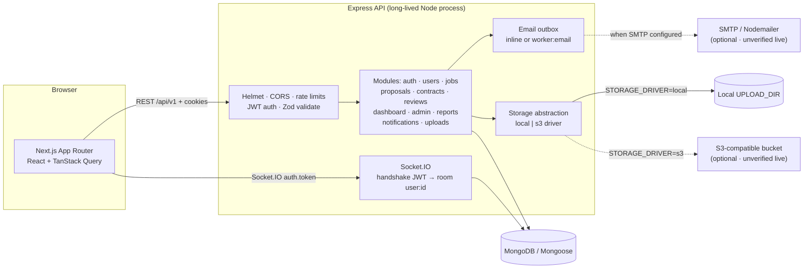
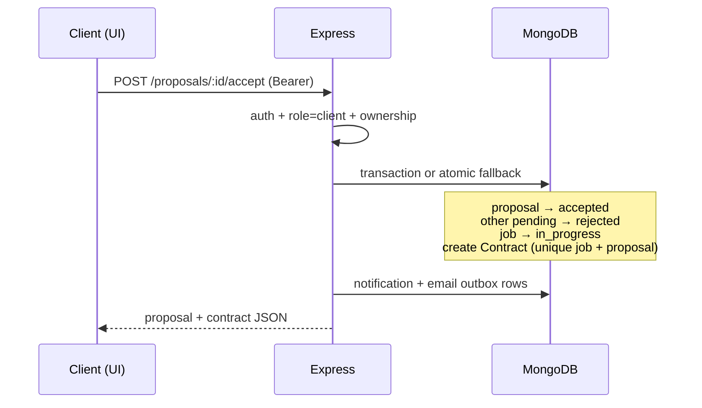
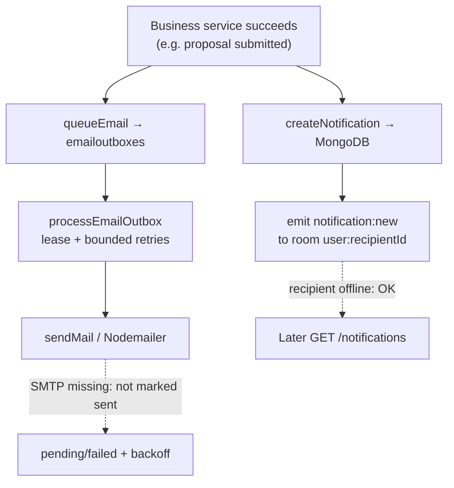
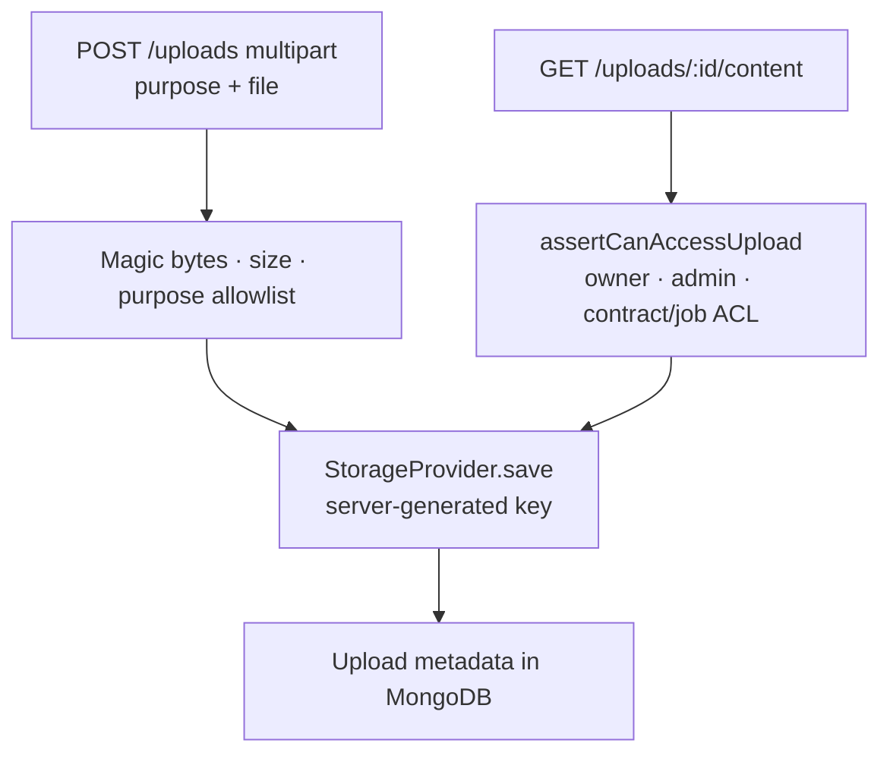

# DevHire Architecture

## High-level view

**Frontend** owns presentation, form validation (UX), and server-state caching (TanStack Query).  
**Backend** owns authentication, authorization, business rules, and persistence.  
**MongoDB** stores users, jobs, proposals, contracts, reviews, notifications, uploads metadata, reports, and audit logs.

Never trust the frontend for security decisions. A hidden “Admin” menu is not authorization — every protected API checks the JWT and role on the server.

### System architecture (Mermaid)



Dashed edges are **optional / unverified** until real credentials and a live round-trip are confirmed. Redis for multi-instance Socket.IO is **documented only**, not drawn as an implemented component.

## Request lifecycle (example: create job — Phase 3)

```text
Form (React Hook Form)
  → Zod (client validation)
  → TanStack Query mutation
  → Axios API client (+ access token)
  → Express route `/api/v1/jobs`
  → auth middleware (JWT)
  → role middleware (client)
  → Zod request validation
  → controller (HTTP shape)
  → service (business rules + ownership)
  → Mongoose model
  → MongoDB
  → JSON response
  → Query cache invalidation (`['jobs']`)
  → UI update
```

Public job browse uses the same stack without auth, with forced `status: open` and validated query params stored on `req.validated` (Express 5 `req.query` is read-only).

## Backend module layout

Each domain lives under `backend/src/modules/<name>/`:

| File | Responsibility |
|------|----------------|
| `*.routes.ts` | URLs + middleware wiring |
| `*.controller.ts` | Parse request, call service, send response |
| `*.service.ts` | Business rules and orchestration |
| `*.model.ts` | Mongoose schema and indexes |
| `*.validation.ts` | Zod schemas for inputs |
| `*.types.ts` | Shared TypeScript types |

Cross-cutting code:

- `config/` — env loading and app settings
- `middleware/` — auth, errors, rate limits
- `utils/` — shared helpers (API responses, tokens)
- `app.ts` — Express app (no `listen`)
- `server.ts` — connect DB, start HTTP + Socket.IO

Separating `app.ts` from `server.ts` lets tests import the app without opening a port.

## Frontend feature layout

| Folder | Responsibility |
|--------|----------------|
| `app/` | Routes and layouts (App Router) |
| `features/` | Domain UI + hooks tied to one feature |
| `components/` | Shared presentational pieces |
| `services/` | Axios wrappers per resource |
| `hooks/` | Shared React hooks |
| `stores/` | Zustand for genuine client UI state only |
| `types/` | Shared TypeScript types |
| `lib/` | Query client, providers, constants |

**Zustand vs TanStack Query:** use Query for anything that comes from the API. Use Zustand for UI-only state (sidebar open, selected filters that are not yet “server truth”).

## Auth model (Phase 2)

```text
Login/Register
  → access JWT (JSON body) + refresh JWT (HttpOnly cookie `devhire_refresh`)
  → frontend stores access token in memory (Zustand)
  → API calls send Authorization: Bearer <access>
  → on 401, Axios tries POST /auth/refresh once (cookie), retries original request
  → logout revokes session row + clears cookie
```

- Access tokens are short-lived; refresh tokens are hashed in `refreshsessions` and **rotated** on each use.
- Refresh **reuse** of a revoked token revokes all sessions for that user.
- Roles come from the database user document during `authenticate` — never from a client-supplied body field.
- Public registration allows only `client` | `freelancer`. Admins: `npm run create-admin`.
- Suspended users cannot login, refresh, or call protected routes.

## Real-time and email

- Socket.IO delivers private notifications after JWT handshake
- Nodemailer sends verification / important updates when SMTP is configured
- App remains usable if email or sockets fail (graceful degradation)

### Proposal acceptance → contract (Mermaid)



**Why it matters:** uniqueness indexes on accepted proposal-per-job and one contract-per-job stop double-hires even under concurrent clicks.

### Notification + email delivery (Mermaid)



MongoDB is the source of truth for notifications. Socket.IO is a live push. Email acceptance ≠ guaranteed inbox delivery.

### Upload + private download (Mermaid)



Public purposes (avatar/portfolio) may be readable without auth. Private deliverables require authorization on **every** content and metadata request.

## Deployment shape

| Piece | Typical host |
|-------|----------------|
| Frontend | Vercel |
| Backend | Render / Railway / Fly.io |
| Database | MongoDB Atlas |

CORS and cookie settings must match the deployed frontend origin.

## Learning notes — Phase 1

1. **Monorepo without a monorepo tool** — two independent `package.json` files keep install/run simple while you learn.
2. **`app.ts` vs `server.ts`** — testable HTTP app vs process bootstrap.
3. **Health endpoint** — first proof that routing, JSON responses, and (optionally) DB connectivity work.
4. **Centralized errors** — throw typed errors in services; one middleware formats `{ success, error }` for clients.
